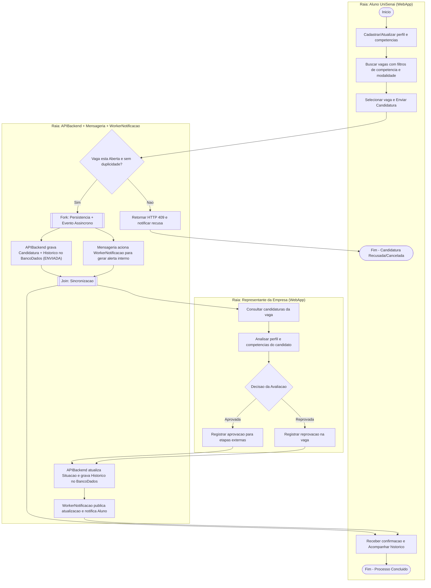
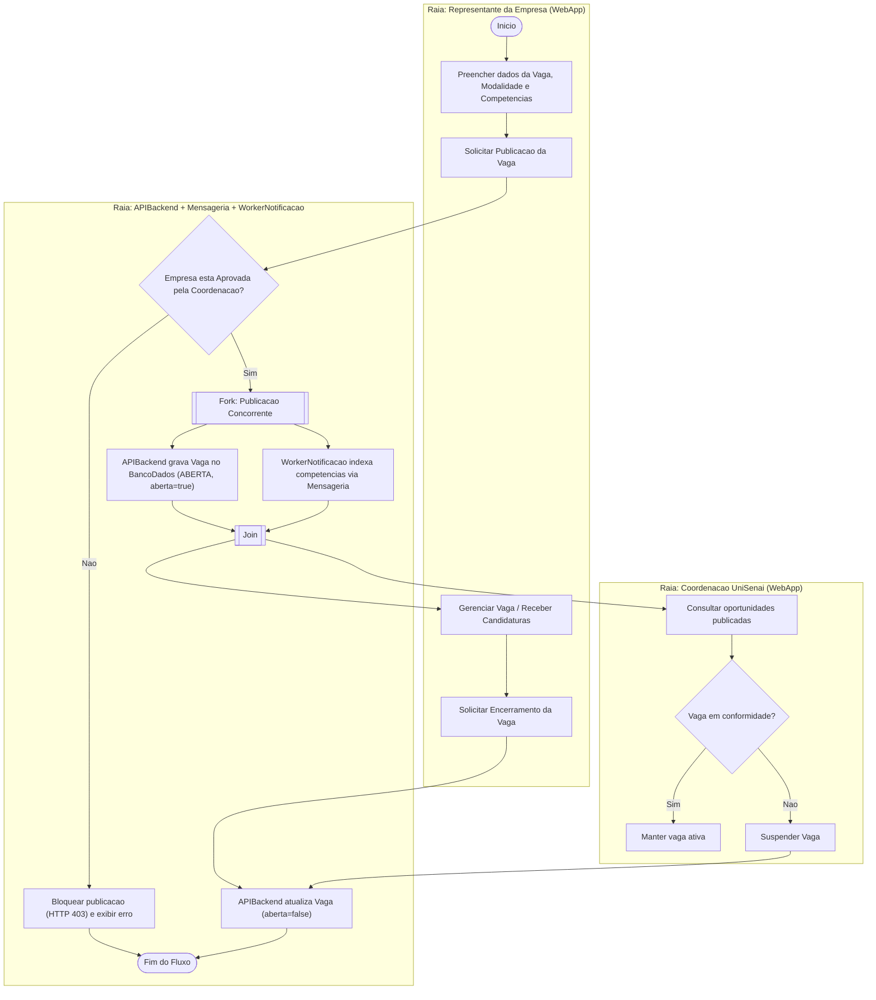
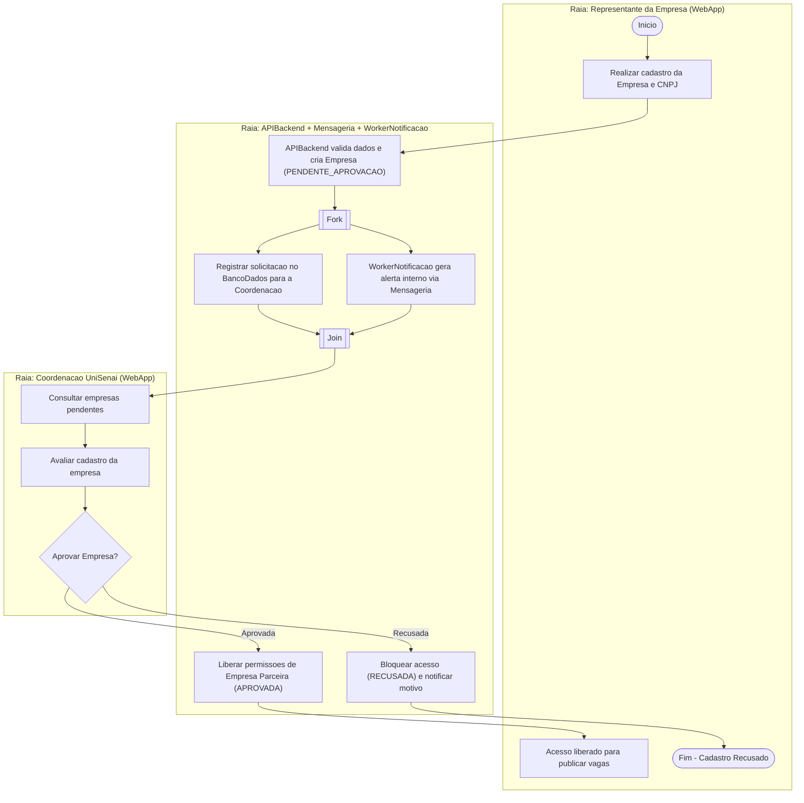
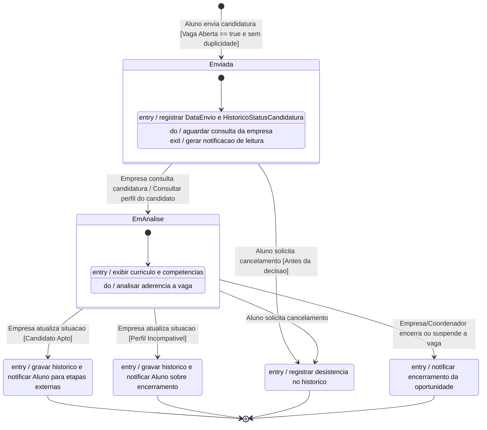
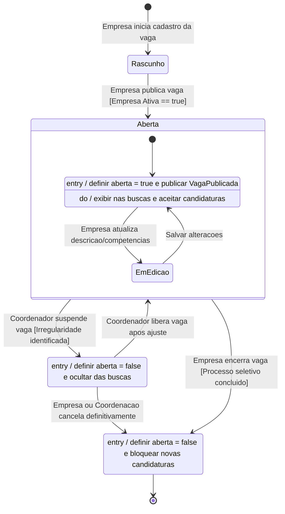
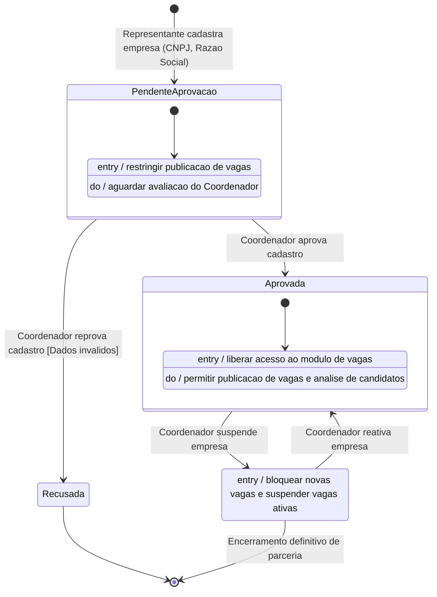

# Diagramas de Atividades com Raias e Máquinas de Estados

Artefatos comportamentais atualizados para explicitar nos blocos *Fork/Join* a atuação coordenada entre `APIBackend`, `BancoDados`, `Mensageria` e `WorkerNotificacao`, mantendo total aderência aos estados das entidades no Diagrama de Classes.

## 1. Atividades — Fluxo de Candidatura e Avaliação (Com Raias e Fork/Join)

## 2. Atividades — Gestão e Publicação de Vaga

## 3. Atividades — Credenciamento de Empresa

## 4. Máquina de Estados — Ciclo de Vida da Candidatura

## 5. Máquina de Estados — Ciclo de Vida da Vaga

## 6. Máquina de Estados — Ciclo de Vida da Empresa

