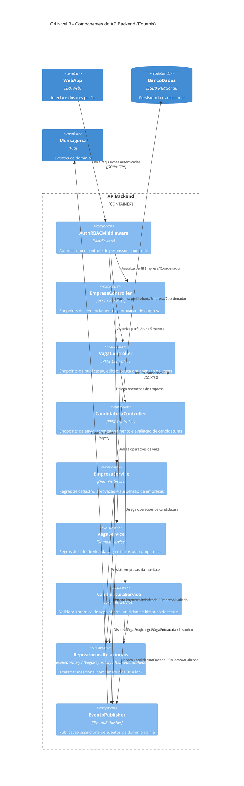

# C4 Nível 3 — Diagrama de Componentes (`APIBackend`)

Decomposição interna do contêiner `APIBackend` demonstrando separação de responsabilidades (Controllers, Services de domínio e abstrações de infraestrutura via Injeção de Dependência).

