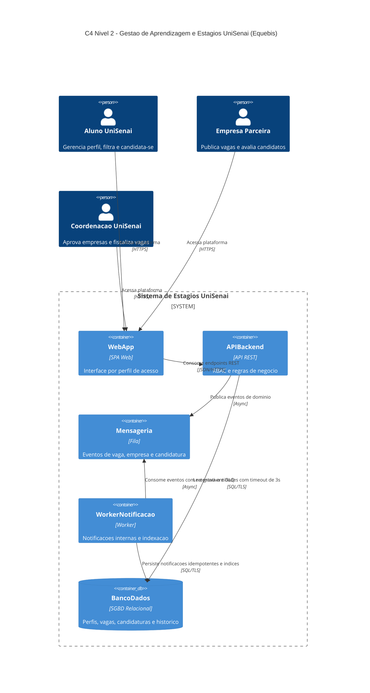

# C4 Nível 2 — Diagrama de Contêineres

Topologia resiliente após auditoria de SPOFs e acoplamento temporal (Sprint 4), introduzindo `Mensageria` e `WorkerNotificacao` para isolar notificações internas e indexação de competências da resposta HTTP síncrona.

