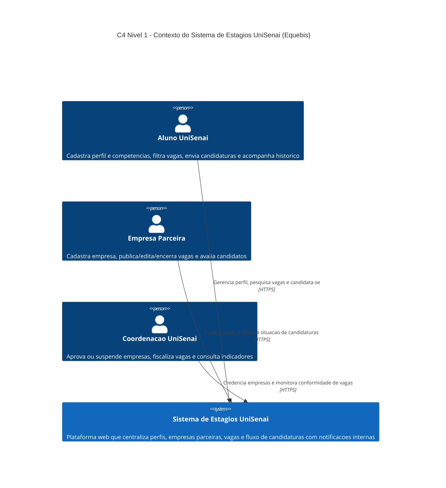

# C4 Nível 1 — Diagrama de Contexto do Sistema

Visão macro do **Sistema Web de Gestão de Aprendizagem e Estágios da UniSenai**, alinhada à Declaração de Escopo da Sprint 2 e à Auditoria Cross-Diagrams da Sprint 4 (sem integrações externas com SGA ou OAuth/SSO de terceiros).

