# Diagrama de Classes e Interfaces — Visão Estrutural

Modelo estrutural consolidado da v1 com:
- Herança de `Usuario` para os três perfis (`Aluno`, `RecrutadorEmpresa`, `Coordenador`);
- Restrição lógica de unicidade `UNIQUE(aluno_id, vaga_id)` em `Candidatura`;
- Trilha de auditoria imutável em `HistoricoStatusCandidatura` (eliminando sobrescrita de histórico);
- Inversão de Dependência (DIP) por meio de interfaces de repositório e `IEventoPublisher`;
- Alinhamento estrito entre métodos públicos de serviço e as chamadas do Diagrama de Sequência.

```mermaid
classDiagram
    class Usuario {
        <<abstract>>
        -int id
        -String nome
        -String email
        -String senhaHash
        -bool ativo
        +autenticar(email: String, senha: String) bool
        +atualizarDados(nome: String, email: String) void
    }

    class Aluno {
        -String curso
        -String telefone
        -String resumoCurriculo
        +atualizarPerfil(curso: String, telefone: String, resumo: String) void
        +adicionarCompetencia(competencia: Competencia) void
    }

    class RecrutadorEmpresa {
        -String cargo
        +obterEmpresaId() int
    }

    class Coordenador {
        -String matriculaInstitucional
        -String departamento
    }

    class Empresa {
        -int id
        -String cnpj
        -String razaoSocial
        -StatusEmpresa status
        +aprovar() void
        +recusar(motivo: String) void
        +suspender(motivo: String) void
        +reativar() void
        +estaAtiva() bool
    }

    class Vaga {
        -int id
        -String titulo
        -String descricao
        -Modalidade modalidade
        -bool aberta
        -StatusVaga status
        +publicar() void
        +editar(titulo: String, descricao: String) void
        +suspender(motivo: String) void
        +liberar() void
        +encerrar() void
        +podeReceberCandidatura() bool
    }

    class Competencia {
        -int id
        -String nome
    }

    class Candidatura {
        -int id
        -int alunoId
        -int vagaId
        -DateTime dataEnvio
        -StatusCandidatura statusAtual
        +registrarTransicao(novoStatus: StatusCandidatura, observacao: String) HistoricoStatusCandidatura
        +cancelar() void
    }

    class HistoricoStatusCandidatura {
        -int id
        -StatusCandidatura statusAnterior
        -StatusCandidatura statusNovo
        -DateTime dataAlteracao
        -String observacao
    }

    class Notificacao {
        -int id
        -String eventoId
        -int destinatarioUsuarioId
        -String mensagem
        -bool lida
        -DateTime criadaEm
        +marcarComoLida() void
    }

    class Modalidade {
        <<enumeration>>
        ESTAGIO
        APRENDIZAGEM
    }

    class StatusEmpresa {
        <<enumeration>>
        PENDENTE_APROVACAO
        APROVADA
        RECUSADA
        SUSPENSA
    }

    class StatusVaga {
        <<enumeration>>
        RASCUNHO
        ABERTA
        SUSPENSA
        ENCERRADA
    }

    class StatusCandidatura {
        <<enumeration>>
        ENVIADA
        EM_ANALISE
        APROVADA
        REPROVADA
        CANCELADA
        ENCERRADA_POR_VAGA
    }

    class IVagaRepository {
        <<interface>>
        +buscarAbertaComLock(vagaId: int) Vaga
        +buscarPorFiltros(competencias: List~int~, modalidade: Modalidade) List~Vaga~
        +salvar(vaga: Vaga) Vaga
    }

    class ICandidaturaRepository {
        <<interface>>
        +existeCandidatura(alunoId: int, vagaId: int) bool
        +salvarComHistorico(candidatura: Candidatura, historico: HistoricoStatusCandidatura) Candidatura
        +buscarPorId(candidaturaId: int) Candidatura
    }

    class IEmpresaRepository {
        <<interface>>
        +buscarPorId(empresaId: int) Empresa
        +salvar(empresa: Empresa) Empresa
    }

    class INotificacaoRepository {
        <<interface>>
        +existeEventoProcessado(eventoId: String) bool
        +salvarIdempotente(notificacao: Notificacao) void
    }

    class IEventoPublisher {
        <<interface>>
        +publicarEvento(tipo: String, payload: String) void
    }

    class CandidaturaService {
        -IVagaRepository vagaRepo
        -ICandidaturaRepository candidaturaRepo
        -IEventoPublisher eventoPublisher
        +enviarCandidatura(alunoId: int, vagaId: int) Candidatura
        +atualizarSituacao(candidaturaId: int, novoStatus: StatusCandidatura, obs: String) void
        +cancelarCandidatura(candidaturaId: int, alunoId: int) void
    }

    class VagaService {
        -IVagaRepository vagaRepo
        -IEmpresaRepository empresaRepo
        -IEventoPublisher eventoPublisher
        +publicarVaga(empresaId: int, vaga: Vaga) Vaga
        +suspenderVaga(vagaId: int, motivo: String) void
        +encerrarVaga(vagaId: int) void
    }

    class EmpresaService {
        -IEmpresaRepository empresaRepo
        -IEventoPublisher eventoPublisher
        +cadastrarEmpresa(empresa: Empresa) Empresa
        +avaliarCadastro(empresaId: int, aprovada: bool, motivo: String) void
    }

    class WorkerNotificacaoService {
        -INotificacaoRepository notificacaoRepo
        -IVagaRepository vagaRepo
        +processarEvento(eventoId: String, tipo: String, payload: String) bool
    }

    Usuario <|-- Aluno
    Usuario <|-- RecrutadorEmpresa
    Usuario <|-- Coordenador

    RecrutadorEmpresa "1..*" --> "1" Empresa : representa
    Empresa "1" --> "0..*" Vaga : publica
    Empresa --> StatusEmpresa : status
    Vaga --> Modalidade : tipo
    Vaga --> StatusVaga : status
    Vaga "0..*" -- "0..*" Competencia : exige
    Aluno "0..*" -- "0..*" Competencia : possui

    Aluno "1" --> "0..*" Candidatura : realiza
    Vaga "1" --> "0..*" Candidatura : recebe
    Candidatura --> StatusCandidatura : statusAtual
    Candidatura "1" *-- "1..*" HistoricoStatusCandidatura : audita
    Usuario "1" --> "0..*" Notificacao : recebe

    CandidaturaService --> IVagaRepository : injeta
    CandidaturaService --> ICandidaturaRepository : injeta
    CandidaturaService --> IEventoPublisher : injeta
    VagaService --> IVagaRepository : injeta
    VagaService --> IEmpresaRepository : injeta
    VagaService --> IEventoPublisher : injeta
    EmpresaService --> IEmpresaRepository : injeta
    EmpresaService --> IEventoPublisher : injeta
    WorkerNotificacaoService --> INotificacaoRepository : injeta
    WorkerNotificacaoService --> IVagaRepository : injeta
```

## Restrições de Persistência Relacional Documentadas
- **Unicidade de Candidatura:** `CONSTRAINT uq_candidatura_aluno_vaga UNIQUE (aluno_id, vaga_id)` impede duplicidade por clique duplo ou retentativa de rede.
- **Idempotência de Notificação:** `CONSTRAINT uq_notificacao_evento UNIQUE (evento_id)` impede gravação de alertas duplicados pelo `WorkerNotificacao`.
- **Integridade de Concorrência:** Leitura de `Vaga` com bloqueio transacional (`SELECT ... FOR UPDATE`) dentro de transação com timeout máximo de `3000ms`.
