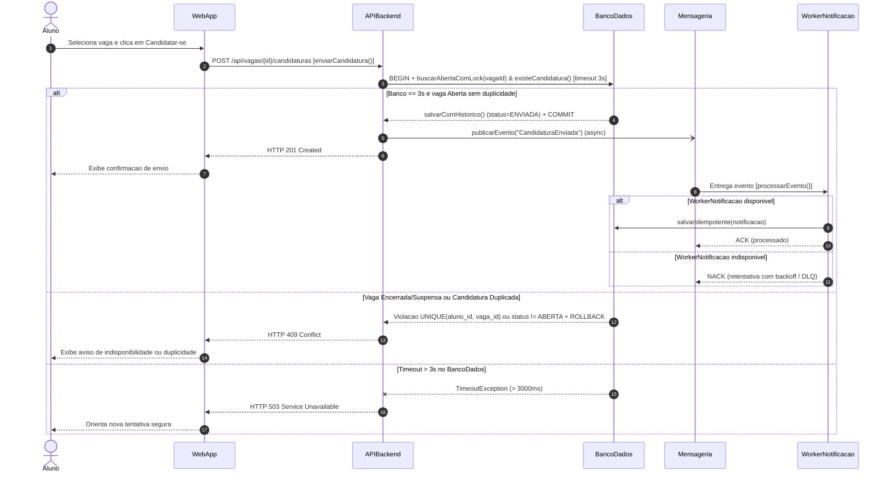
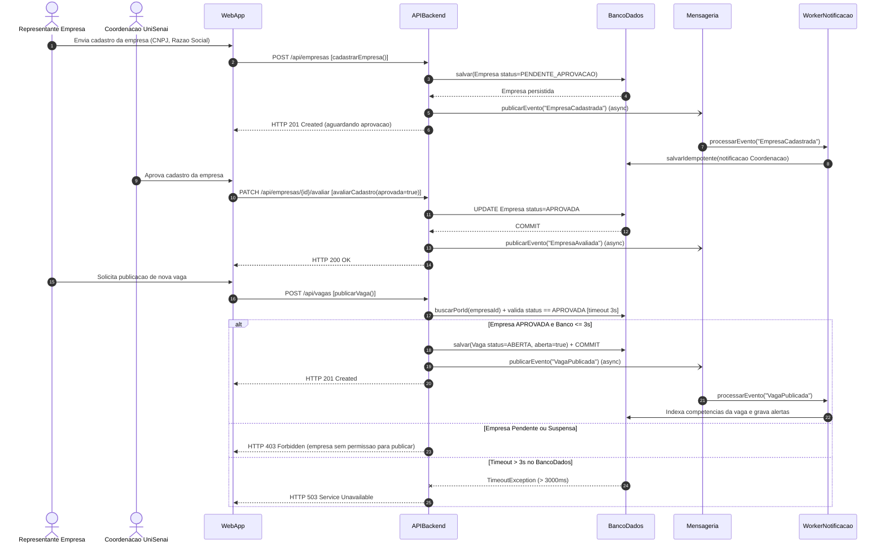

# Diagramas de Sequência Resilientes — Visão Comportamental

Todos os participantes reproduzem exatamente a nomenclatura do Modelo C4 Nível 2 (`WebApp`, `APIBackend`, `BancoDados`, `Mensageria`, `WorkerNotificacao`) e invocam assinaturas existentes no Diagrama de Classes (`CandidaturaService`, `VagaService`, `EmpresaService`, `WorkerNotificacaoService`).

## 1. Fluxo de Candidatura com Engenharia do Caos (Timeout 3s, Conflito e DLQ)

## 2. Fluxo de Credenciamento de Empresa e Publicação de Vaga

