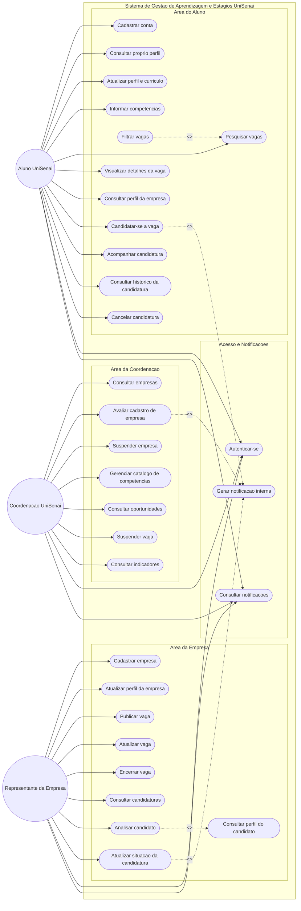

# Diagrama de Casos de Uso — Visão Funcional (Escopo v1)

Casos de uso consolidados a partir da Declaração de Escopo da Sprint 2 e revisados na auditoria da Sprint 4 (mantendo exclusivamente os três perfis da v1, filtros manuais por competência/modalidade e notificações internas).

